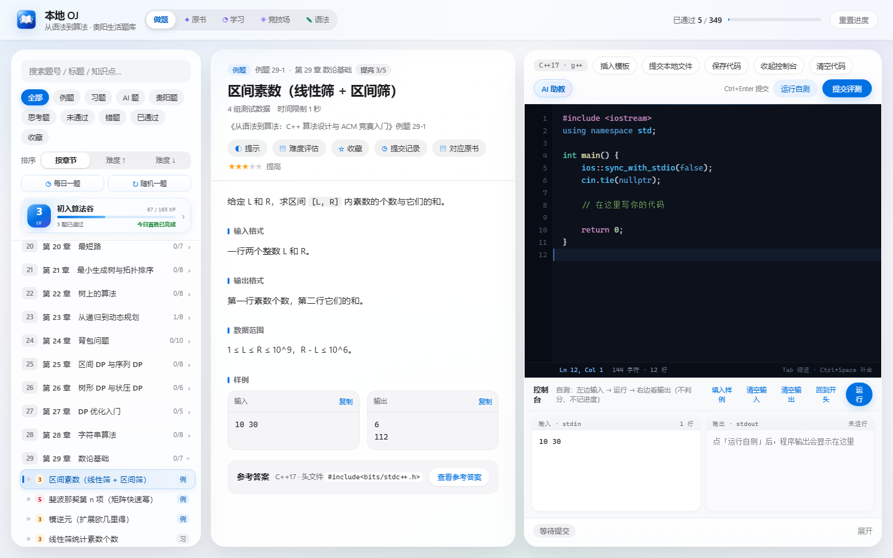
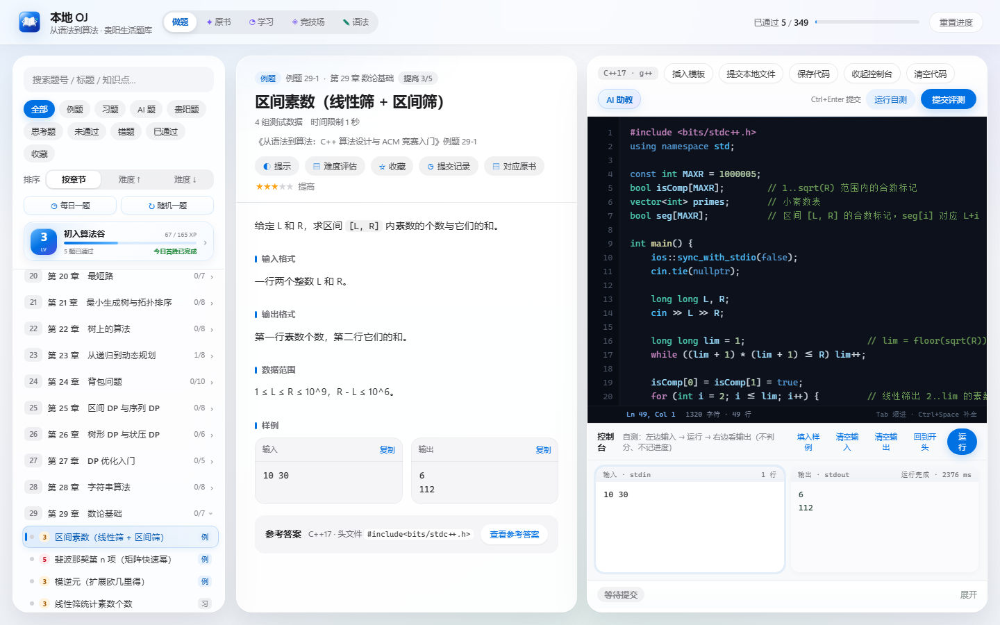
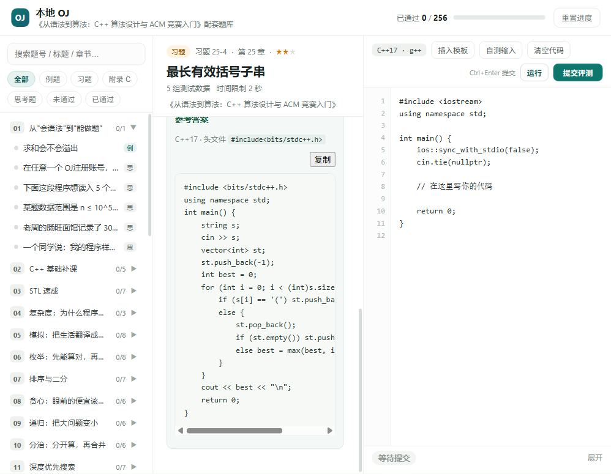
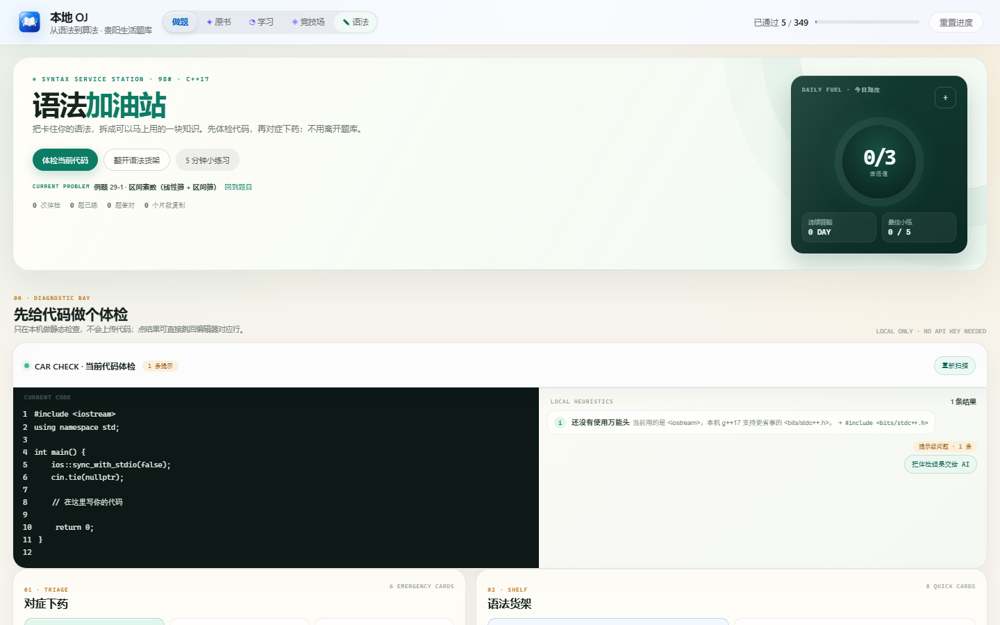

# 本地 OJ · 从语法到算法

> **一个只在你电脑上运行的 ACM 在线判题系统。**  
> C++17 · 本地 g++ 判题 · 洛谷式控制台 · 原书联动 · AI 助教 · 算法竞技场 · 语法加油站

<p align="center">
  
</p>

<p align="center">
  <a href="https://github.com/Mikecode985/destop-oj/stargazers"></a>
  <a href="https://github.com/Mikecode985/destop-oj/network/members"></a>
  <a href="https://github.com/Mikecode985/destop-oj/blob/main/LICENSE"></a>
  
  
</p>

<p align="center">
  <a href="https://github.com/Mikecode985/destop-oj/archive/refs/tags/v1.0.0.zip">
    
  </a>
  &nbsp;
  <a href="https://github.com/Mikecode985/destop-oj">
    
  </a>
</p>



---

## 这是什么

**本地 OJ** 是一个完全离线运行的算法刷题与竞赛训练环境。它把书稿《从语法到算法：C++ 算法设计与 ACM 竞赛入门》的例题、习题、思考题，以及 100 道贵阳生活原创题，整理成了可以自测、提交、判题、看参考答案的题库。

它不依赖在线评测网站，不会把你的代码上传到云端。判题由本机 `g++` 执行，题库、答案、进度和提交记录都在本地文件里。

**适合：**

- 正在学 C++ 语法、准备蓝桥杯 / ACM / 校赛的学生；
- 想要一个“打开就能写题”的本地训练环境；
- 想研究一个小型 OJ 如何做题库、判题、前端和 AI 联动的人；
- 喜欢苹果风 UI、游戏化成长和可视化学习报告的人。

---

## 一键下载

### 方式 A：下载 ZIP（推荐给第一次使用）

点击上方 **「⬇️ 一键下载」**，或直接打开：

**https://github.com/Mikecode985/destop-oj/archive/refs/tags/v1.0.0.zip**

发布页：**https://github.com/Mikecode985/destop-oj/releases/latest**

下载后解压，双击 **`启动本地OJ.bat`** 即可。

### 方式 B：Git clone

```bash
git clone https://github.com/Mikecode985/destop-oj.git
cd destop-oj
python server.py --open
```

### 方式 C：手动启动

```bash
python server.py
# 浏览器打开 http://127.0.0.1:8765
```

Windows 上也可以直接双击 `启动本地OJ.bat`。它会检测 `py -3` 或 `python`，然后启动本地服务并打开浏览器。

> 第一次运行前只需要准备好 **Python 3.10+** 和 **支持 C++17 的 g++**。  
> 关闭运行中的命令行窗口 = 停止本地 OJ，不会残留后台服务。

---

## 功能亮点

| 模块 | 你能做什么 |
|---|---|
| **做题** | 标准题面、输入输出格式、数据范围、样例、提示、四维难度评估、参考答案 |
| **本地判题** | 用本机 `g++` 编译运行，支持 AC / WA / TLE / RE / CE / MLE 等结果 |
| **洛谷式控制台** | 自定义输入、运行代码、查看 stdout / stderr，像在线 IDE 一样自测 |
| **VS Code 风编辑器** | C++ 语法高亮、补全、自动缩进、光标定位、保存代码文件 |
| **本地文件提交** | 选择本机 `.cpp` 文件直接提交，不必复制粘贴 |
| **原书联动** | 导入原书 39 节内容，题目与章节互跳，划词后直接问 AI 助教 |
| **AI 助教** | 兼容 OpenAI 接口，支持答疑、诊断、复盘、按难度和知识点原创出题 |
| **AI 原创题** | 生成题面、样例和 4–6 组 tests，先由本机 g++ 校验参考答案，再进入题库 |
| **LaTeX 公式** | `$...$` / `$$...$$` 行内与块级公式、上下标、分数、根号、常用数学符号 |
| **算法竞技场** | 闪电赛 / 标准赛 / 远征赛，积分、罚时、段位、赛后 AI 复盘 |
| **语法加油站** | 代码体检、错误急救卡、语法货架、5 分钟小练习，纯本地记录 |
| **游戏化成长** | XP、等级、称号、每日首胜、冒险者档案 |
| **学习看板** | 热力图、提交记录、代码回放、薄弱知识点、Markdown 学习报告导出 |

### 五视图

五个入口，覆盖从“学”到“练”再到“复盘”的完整闭环：

1. **做题** — 题库、题面、编辑器、自测、提交；
2. **原书** — 39 节电子书、章节导学、思维导图、题目反查；
3. **学习** — 进度、热力图、提交历史、能力画像、报告导出；
4. **竞技场** — 限时赛、积分与段位、赛后总结；
5. **语法** — 本地代码体检、错误急救、语法练习。

---

## 界面预览

### 题目工作台


### 洛谷式控制台



### C++17 参考答案



### 语法加油站



---

## 题库构成

仓库内置 **399 道固定题**，其中 **348 道带本地测试数据、可直接判题**：

| 类别 | 数量 | 说明 |
|---|---:|---|
| 例题 | 94 | 书中例题，含题面、样例、数据范围和参考代码 |
| 习题 | 118 | 章末习题中可标准化为 OJ 题的部分 |
| 思考题 | 51 | 证明、构造反例、改错、手算类，保留题面与提示 |
| 附录 C | 36 | 原贵阳主题练习，去重后保留 |
| 贵阳生活原创 | 100 | 20 个题族 × 5 种不同问法，全部可判题 |
| **合计** | **399** | **348 道可判题** |

难度覆盖 1–5 级：

```text
入门 1：26 题    基础 2：100 题    提高 3：128 题
进阶 4：133 题   挑战 5：12 题
```

每道可判题都包含：

- 标准题面、输入格式、输出格式、数据范围；
- 至少一组样例；
- 多组本地 tests；
- 两层提示；
- 知识点标签；
- 四维难度评估；
- 首行 `#include <bits/stdc++.h>` 的 C++17 参考答案。

### 编号规则

| 前缀 | 含义 | 示例 |
|---|---|---|
| `ex-章-例` | 例题 | `ex-24-03` |
| `p-章-题` | 习题 | `p-05-01` |
| `c-序号` | 附录 C | `c-01` |
| `gy-序号` | 贵阳生活原创 | `gy-001` |
| `ai-时间-序号` | AI 按需生成 | `ai-20261116-001` |

---

## 环境要求

### Windows（推荐）

- Windows 10 / 11；
- Python **3.10+**；
- MinGW-w64 `g++`（支持 C++17），并已加入 `PATH`；
- Chrome / Edge / Firefox 任一现代浏览器。

检查：

```powershell
python --version
g++ --version
```

如果 `g++` 不在 `PATH` 中，把 MinGW 的 `bin` 目录加入系统环境变量，例如：

```text
C:\mingw64\bin
```

Dev-C++ 自带的 TDM-GCC 也可以使用，只要 `g++ --version` 能正常输出。

### macOS / Linux

项目本身是 Python 标准库 + 原生前端，不依赖第三方 Python 包；只要系统有 `g++` 和 Python 3 即可运行：

```bash
python3 server.py --open
```

---

## AI 助教配置

AI 功能是**可选**的，不配置也能正常刷题、判题、看题解和使用竞技场。

1. 打开任意题目，点击右侧 **AI 助教**；
2. 打开 **AI 设置**，填入兼容 OpenAI Chat Completions 的服务信息：

| 字段 | 示例 | 说明 |
|---|---|---|
| API Key | 你的 Key | 只保存在本机浏览器 `localStorage` |
| Base URL | `https://api.deepseek.com/v1` | 任意兼容 OpenAI 的接口 |
| Model | `deepseek-chat` | 以服务商实际模型名为准 |

3. 保存后可以：

- 对题面、代码、编译错误、WA 用例提问；
- 让 AI 按“诊断 / 复盘 / 出题”模式工作；
- 拉动难度条，让 AI 按知识点原创一道可判题；
- 在原书中划词，直接带着上下文问 AI。

**安全说明：**

- API Key 只保存在浏览器 `localStorage['oj.ai.config']`，不会写入题库、提交记录或 Git 仓库；
- 不要把 Key 写进 `README`、脚本、截图或 Issue；
- AI 请求经过本地 `/api/ai` 转发，仓库本身不包含任何云端密钥。

---

## 快速上手

### 1. 启动

双击：

```text
启动本地OJ.bat
```

或：

```bash
python server.py --open
```

浏览器会自动打开：

```text
http://127.0.0.1:8765/
```

### 2. 选题

左侧题库支持：

- 全部 / 例题 / 习题 / AI 题 / 贵阳题 / 思考题；
- 未通过 / 错题 / 已通过 / 收藏；
- 按章节、难度升序、难度降序排序；
- 按题号、标题、知识点搜索；
- 每日一题、随机一题。

### 3. 写代码并自测

1. 在编辑器里写 C++17；
2. 在“控制台”输入自定义 stdin；
3. 点“运行”查看输出；
4. 点“提交”让本机 g++ 跑完全部 tests；
5. AC 后会获得 XP，并记录到学习看板。

### 4. 查看提示与答案

题面工具栏里有：

- **提示**：逐层展开，不剧透；
- **难度评估**：四维能力条；
- **参考答案**：默认折叠，点击后显示首行 `#include <bits/stdc++.h>` 的 C++17 代码；
- **提交记录**：查看历史代码、用例和判题信息。

### 5. 使用原书

底部切换到 **原书**：

- 左侧 39 节目录；
- 中间是章节正文 / 插图 / 原书 PDF；
- 每章有导学卡、思维导图、学习路线、易错提醒；
- 题面里的“对应原书”可以跳回相应小节；
- 选中正文后，弹出“问 AI”工具条。

### 6. 竞技场与语法加油站

- **竞技场**：闪电赛 20 分钟 / 2 题、标准赛 45 分钟 / 3 题、远征赛 75 分钟 / 4 题；
- 赛后给出 S/A/B/C/D 评级、逐题得分、罚时和段位变化；
- **语法**：本地代码体检 + 6 张错误急救卡 + 8 张语法货架 + 5 分钟小练习。

---

## 项目结构

```text
destop-oj/
├─ server.py                 # Python 标准库 HTTP 服务 + g++ 判题
├─ 启动本地OJ.bat             # Windows 一键启动
├─ web/
│  ├─ index.html             # 五视图入口
│  ├─ app.js                 # 做题 / 学习 / AI / 原书 / 游戏化
│  ├─ style.css              # 苹果风主样式
│  ├─ grammar.js/.css        # 语法加油站
│  ├─ arena.js/.css          # 算法竞技场
│  ├─ rpg.css                # 冒险者档案
│  └─ book/                  # 原书电子版与插图
├─ data/
│  ├─ problems.json          # 399 道固定题库
│  └─ solutions/             # C++17 参考答案
├─ tools/                    # 题库构建、难度评估、验收脚本
├─ docs/screenshots/         # README 截图
├─ LICENSE
└─ README.md
```

运行时会在 `data/` 下自动生成：

```text
progress.json       # 本机做题进度
submissions.json    # 本机提交历史（含代码回放）
server_stdout.log
server_stderr.log
```

这些文件已被 `.gitignore` 忽略；**不会把个人做题记录提交到 GitHub**。

---

## 技术架构

```text
┌─────────────────────────────┐
│ 浏览器前端（原生 HTML/JS）   │
│ 五视图 / 编辑器 / 控制台     │
└──────────────┬──────────────┘
               │ HTTP / JSON
┌──────────────▼──────────────┐
│ Python 标准库 HTTP Server   │
│ /api/problems /api/submit   │
│ /api/selfrun /api/ai        │
└──────────────┬──────────────┘
               │ subprocess
┌──────────────▼──────────────┐
│ 本机 g++ (C++17)            │
│ 编译 → 运行 → 比对 tests     │
└─────────────────────────────┘
```

设计取舍：

- **不用数据库**：题库、进度、提交都是可读 JSON，便于备份和审查；
- **不用云判题**：代码只在本机编译运行，断网也能刷题；
- **不用前端框架**：零构建、零 `node_modules`，下载即用；
- **AI 可选**：没有 Key 时全部本地功能照常工作；
- **题书联动**：题目、章节、原书段落和 AI 上下文共享同一套 ID。

---

## 开发与验收

### 语法检查

```bash
python -m py_compile server.py
node --check web/app.js
node --check web/grammar.js
node --check web/arena.js
```

### 本地验收

```bash
python tools/acceptance_grammar.py
python tools/acceptance_learning.py
python tools/acceptance_arena.py
python tools/acceptance_workbench.py
python tools/acceptance_book.py
```

验收覆盖五视图接线、题库数据、本地存储、AI 出题工作台、编辑器、原书章节、竞技场和语法模块。

### 题库构建脚本

`tools/` 里保留了题目抽取、难度评估、答案生成和去重脚本，方便二次开发；使用前请先阅读脚本头部的路径约定。

---

## 常见问题

### 1. 双击 bat 后窗口一闪而过

在命令行里运行：

```powershell
python server.py --open
```

看具体报错。最常见原因是 Python 不在 `PATH`，或 `g++` 不在 `PATH`。

### 2. 提交后一直 CE

先在本机命令行验证：

```powershell
g++ --version
```

再用一个最小程序编译：

```powershell
@'
#include <bits/stdc++.h>
int main(){return 0;}
'@ | Set-Content -Encoding utf8 test.cpp
g++ -std=c++17 test.cpp -o test.exe
```

如果这里失败，问题在编译器环境，不在 OJ。

### 3. 端口 8765 被占用

```bash
python server.py --port 9000 --open
```

### 4. 浏览器还是旧界面

前端资源带版本号。刷新时使用：

```text
http://127.0.0.1:8765/?v=20261116z1
```

或 `Ctrl + F5` 强制刷新。

### 5. AI 出题报错

- 确认 Key、Base URL、模型名都正确；
- 先让 AI 生成 4–6 组 tests；
- 把错误卡片里的“首个失败用例 / 编译信息”贴给 AI 助教；
- 如果题面有 LaTeX，JSON 字符串里的反斜杠要双写，或优先使用 Unicode（`…`、`≤`、`∈`）。

### 6. 做题记录在哪

```text
data/progress.json
data/submissions.json
```

备份这两个文件即可迁移进度；删除它们等于清空本机做题记录。

---

## 数据与隐私

- 仓库只包含**公共题库、参考答案、前端和工具**；
- `progress.json`、`submissions.json`、日志和 AI Key **不进入仓库**；
- 本地 OJ 不会主动上传代码或做题记录；
- 只有在你主动使用 AI 功能时，题面/代码上下文才会发送到你配置的 AI 服务商；
- 如果要在公共 Issue 里贴错误，请先删除代码中的个人信息和 API Key。

---

## 贡献

欢迎提交：

- 题目描述、样例、测试数据或参考答案修正；
- 新的本地题库 / 知识点标签；
- UI、交互、性能和可访问性改进；
- 文档、截图和验收脚本改进。

提交前请：

1. 用 `python -m py_compile` 和 `node --check` 做基础检查；
2. 不提交 `data/progress.json`、`data/submissions.json`；
3. 不提交任何 API Key、Cookie 或个人路径；
4. 一道题一个 Issue / PR，附上题号和复现步骤。

---

## License 与内容说明

- **代码**：MIT License，见 [LICENSE](LICENSE)。
- **题库题面、书中文字、插图与 PDF**：版权归原书作者/权利人所有，本项目仅用于学习与本地练习；如权利人希望调整或移除，请在 Issue 中说明。
- 贵阳生活原创题、前端实现、验收脚本与 README 由本项目维护者整理。

---

<p align="center">
  <b>如果这个项目对你有帮助，点一个 ⭐ 就是最好的支持。</b><br>
  <sub>Built for learning. Run locally. Keep coding.</sub>
</p>
